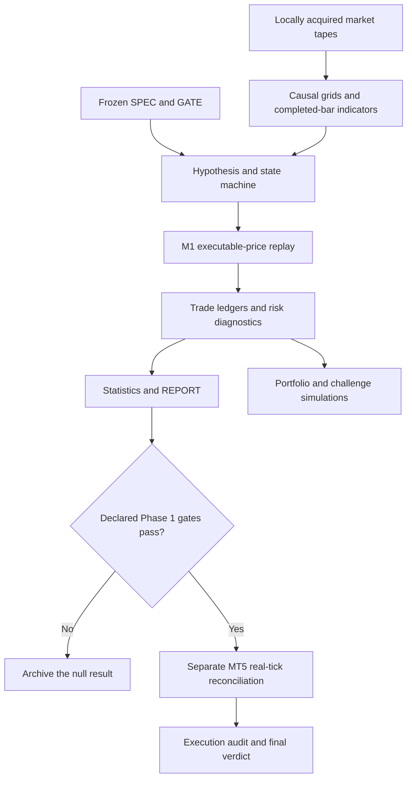

# Trading Engine

**A research and execution-validation workspace for systematic CFD and futures-proxy trading.**

Trading Engine studies a practical question: does a trading idea still have an
edge after causal signal construction, executable bid/ask prices, financing,
intrabar stops and account constraints?

The repository contains Python hypothesis evaluations, native MetaTrader 5
Expert Advisors, execution reconciliation tools, portfolio simulations and
frozen research records. It also preserves the earlier CAIRO machine-learning
ensemble in a separate archive.

**Status:** research software. No strategy in this repository is presented as a
currently verified, profitable live or prop-ready trading product. Some offline
results are positive; failed replications, marginal real-tick results and rejected
strategies are retained alongside them.

## Contents

- [What the project does](#what-the-project-does)
- [Two systems, separate scopes](#two-systems-separate-scopes)
- [Foundation: Reinforce and CAIRO](#foundation-reinforce-and-cairo)
- [Architecture](#architecture)
- [Quick start](#quick-start)
- [Repository layout](#repository-layout)
- [Data and reproducibility](#data-and-reproducibility)
- [Research workflow](#research-workflow)
- [Strategies and current evidence](#strategies-and-current-evidence)
- [Execution, costs and risk](#execution-costs-and-risk)
- [MetaTrader 5](#metatrader-5)
- [Tests and continuous integration](#tests-and-continuous-integration)
- [Documentation](#documentation)
- [License and attribution](#license-and-attribution)

## What the project does

- Replays M1 price tapes with explicit entry/exit price sides, opening gaps and
  adverse-first stop/target collisions.
- Builds causal multi-timeframe indicators and DST-aware New York session clocks.
- Tests trend, breakout, mean-reversion, market-structure and ML hypotheses under
  declared execution assumptions.
- Reconciles Python reference signals and trade ledgers with MT5 tester output.
- Measures expectancy, drawdown, R-multiples and moving-block bootstrap uncertainty.
- Studies financing, concurrency limits and Monte Carlo challenge outcomes.
- Keeps SPEC, GATE and REPORT documents so rejected hypotheses remain auditable.

There is no single universal backtester behind every historical study. Research
scripts share helpers where appropriate, while individual implementations and
frozen assumptions remain visible for audit.

## Two systems, separate scopes

| System | Location | Scope and status |
| --- | --- | --- |
| Active strategy research | `evaluate/`, `ea/`, `Include/`, `scripts/`, `data/results/` | Explicit hypothesis tests, causal replay, MT5 reconciliation and account-risk experiments |
| Original Reinforce / CAIRO framework | [Separate foundation repository](https://github.com/miladssamiei/reinforce) | Full original learning, training, feature, ensemble and inference architecture |
| Later CAIRO integration archive | [archive/legacy/](archive/legacy/README.md) | Python-to-MT5 bridge and job orchestration retained with this project's history |
| Standalone experiment | [archive/experiments/](archive/experiments/README.md) | Exploratory SP2L Python bot; separate from the frozen native SP2L baseline |

The CAIRO archive preserves its own internal layout. The original training
framework is now documented and published separately in Reinforce; model
checkpoints and databases remain local. The old GUIDE is historical context,
not the active system's installation guide.

## Foundation: Reinforce and CAIRO

Trading Engine grew out of **[Reinforce / CAIRO](https://github.com/miladssamiei/reinforce)**,
the original project behind the broader idea. CAIRO—Collective AI Reinforced
Intelligence for trading Outcomes—explored a collective decision system built
from independently trained learning algorithms, a common trading action
interface and a separate risk/execution layer.

The original framework brought together **PPO, IMPALA, APPO, SAC, TQC,
LightGBM and a Decision Transformer**. It included rolling walk-forward training,
technical and optional regime/context features, saved model probabilities,
uniform/weighted/regime-aware aggregation, sizing, portfolio coordination,
checkpoint preparation, HTTP inference and MetaTrader integration. This is the
foundation of the project, beyond the smaller bridge snapshot archived here.

The original hypothesis was that different learning objectives could contribute
complementary trading decisions. Models emitted SELL/HOLD/BUY outputs; the
ensemble combined them before independent controls determined the permitted
execution request. Model agreement and high offline metrics required empirical
validation, rather than establishing an edge by themselves.

The attempt to carry these model decisions into MT5 led to the execution audits
in this repository. The recorded performance gap motivated the later emphasis
on explicit causal signals, executable price sides, frozen research gates,
real-tick reconciliation and marked-equity risk. Those findings concern the
validation claim; the original architecture and idea are documented in full in
their own repository.

Read the **[Reinforce overview](https://github.com/miladssamiei/reinforce#readme)**,
its **[model guide](https://github.com/miladssamiei/reinforce/blob/main/docs/MODELS.md)**
and the **[project lineage](docs/PROJECT_LINEAGE.md)** for the complete relationship.

## Architecture



Portfolio simulations are conditional experiments. They do not replace
chronological marked-equity replay or establish a broker's actual pass rate.

## Quick start

### 1. Install the offline environment

Python **3.11 or 3.12** is the recommended starting point. The core library
metadata permits Python 3.11–3.13; individual optional packages may narrow that
range. Historical full evaluations were run on Windows in a dedicated environment.

```powershell
git clone https://github.com/miladssamiei/trading-engine.git
cd trading-engine
python -m venv .venv
.\.venv\Scripts\python.exe -m pip install --upgrade pip
.\.venv\Scripts\python.exe -m pip install -e ".[dev]"
```

On Linux/macOS, substitute `.venv/bin/python` for the Windows Python path.
No broker connection, credentials, paid feed or market-data download is required
for the offline test suite and synthetic example.

### 2. Verify the mechanics

```powershell
.\.venv\Scripts\python.exe -m pytest -q
.\.venv\Scripts\python.exe examples/bracket_replay.py
```

The example calls the frozen Edris evaluator's synthetic checks for price-side
costs, stop priority, opening gaps, pivot confirmation, RSI seeding and DST
boundaries. It **does not estimate trading performance**.

### 3. Add optional research packages

```powershell
.\.venv\Scripts\python.exe -m pip install -e ".[research,dev]"
# Windows only; required only by modules that use the terminal API:
.\.venv\Scripts\python.exe -m pip install -e ".[mt5]"
```

The optional research group covers common ML/statistical studies. It does not
install CAIRO's external training stack or guarantee that every historical
download service is available. Read a script's imports and frozen specification.

## Repository layout

```text
trading-engine/
├── evaluate/               Python studies, replay engines and reconciliation
├── ea/                     Native MQL5 research and execution EAs
├── Include/                Shared MQL5 guard code
├── scripts/                Quote observation and execution diagnostics
├── configs/examples/       Credential-free tester template
├── deploy/infrastructure/  Native guard/preset verification source
├── data/results/           Published frozen SPEC/GATE/REPORT documents
├── examples/               Synthetic, data-free execution check
├── tests/                  Offline regression and boundary tests
├── docs/                   Architecture, methods, data and evidence index
├── archive/legacy/         CAIRO system and historical integration tests
├── archive/experiments/    Standalone exploratory bot
├── tools/                  Publication/export audit
└── .github/workflows/      Offline CI configuration
```

Raw price tapes, terminal folders, `.env` files, account exports, checkpoints,
compiled `.ex5`/DLL files, SQLite queues, logs and personal scratch scripts are
excluded. The publication starts with clean Git history rather than importing
the local workspace's large runtime artifacts. See [publication policy](docs/PUBLICATION.md).

## Data and reproducibility

Market data must be obtained separately under its provider's terms. The project
uses verified bid-price proxy exports and, for selected MT5 studies, imported
real ticks. A futures-named proxy such as `GC`, `ES` or `NQ` does not establish
that the tape is a tradable exchange order book.

Common M1 input schema:

```csv
time,open,high,low,close,tick_volume
```

`time` is Unix seconds in UTC. Prices are native instrument units; EURUSD pip
conversion is typically 0.0001, while JPY pairs use 0.01. Some studies use
semicolon-delimited MT5 exports instead. Follow the individual loader.

Typical local input paths:

| Instrument | Expected input |
| --- | --- |
| US500 | `data/results/vwap_2021_2026/us500tick_m1.csv` |
| US500 M5 | `data/results/orb_2021_present/us500tick_m5.csv` |
| XAUUSD | `data/results/xauusd_onboarding/xauusdtick_m1.csv` |
| EURUSD | `data/results/eurusd_onboarding/eurusdtick_m1.csv` |
| US100 | `data/results/virgin_assets/ustech_m1.csv` |
| BTCUSD / ETHUSD | `data/results/virgin_assets/btc_m1.csv`, `eth_m1.csv` |

**Historical reports are not an out-of-the-box reproducibility bundle.** The
public repository omits the source tapes, terminal caches and many generated
ledgers. Some scripts retain original Windows paths. Reports claiming coverage
through 2026 can have different tape end dates. Full reproduction requires the
matching data revision, symbol specifications, dependencies and environment.

Do not delete a historical report to make a script rerun. Start a **new versioned
study directory**, freeze its assumptions, and explicitly configure the new
output path. Several evaluators deliberately refuse to overwrite existing reports.
See [data conventions](docs/DATA.md) and the [study index](docs/STUDIES.md).

## Research workflow

1. **SPEC first:** write a plain-text mechanism, inputs, causal timing, costs,
   thresholds, stopping rules and honesty constraints before implementation.
2. **GATE next:** extract every gate verbatim before the first run.
3. **Phase 1:** implement, run and report the Python experiment, including failures.
4. **Phase 2:** only advance passing candidates to a separately declared execution test.
5. **Freeze:** retain the original SPEC/GATE/REPORT; corrections get new artifact names.

Independent walk-forward evidence, adequate sample size and year-sign agreement
are required before a result is described as validated. An owner-requested
exploratory gate with a smaller sample is not equivalent. ML work uses frozen
feature/model definitions and causal walk-forward folds, not post-hoc model swaps.

Many hypotheses have been tried. Per-study bootstrap probabilities are
conditional diagnostics, not a correction for the entire research search.
See [the complete protocol](docs/RESEARCH_PROTOCOL.md).

## Strategies and current evidence

The repository covers opening-range breakout, spike/gap structures, Keltner and
Donchian macro trends, RSI/BB mean reversion, grid baskets, market-structure
setups, ML overlays and portfolio-risk experiments. Preservation does not imply
endorsement.

| Evidence area | Current interpretation |
| --- | --- |
| ORB / SP2L | Individually reconciled under generated Model=0 ticks; Model=4 real-tick performance is marginal |
| Regime rotation | Offline Phase 1 passed; MT5 Phase 2 failed under both tick models |
| Gold / crypto macro trends | Positive financed-proxy studies exist; live cash, full equity guards and complete EA parity are not established |
| EURUSD H1 grid | Very high closed-basket win rate hides substantial floating exposure; controlled validation was **not adopted** |
| Edris H4/M30 sweep-divergence-inside-bar | All six declared asset/arm cells failed Phase 1 gates |
| Historical CAIRO ensemble | Offline performance did not transfer through the MT5 bridge; archived no-go |

The frozen Model=4 baselines record ORB **437 trades, +114.91 native units,
daily Sharpe 0.0745**, and SP2L **1,349 trades, +138.65 native units,
common-universe daily Sharpe 0.133**. These belong to their historical cost,
capital and session conventions. They are not live returns or current FTMO quotes.

[Results and limitations](docs/RESULTS.md) links directly to the underlying
records. Always distinguish daily annualized Sharpe from unannualized
per-trade R Sharpe.

## Execution, costs and risk

- **Bid/ask:** a fixed round-trip cost is embedded once into executable fills;
  long entries use ask and short exits use ask where specified.
- **Intrabar ambiguity:** adverse stop priority is used when an M1 bar touches
  both stop and target. Opening gaps can exceed the nominal stop loss.
- **Timing:** completed bars only; confirmed pivots become available after their
  right-hand confirmation bars. Synthetic grid rows must not create executable fills.
- **Timezones:** UTC source times, New York wall sessions, NY 17:00 daily anchors,
  and account-reset clocks are distinct and handled per study.
- **Costs:** fixed spread floors, percentage commissions and financing assumptions
  differ by study. Read the frozen SPEC; there is no universal current-cost claim.
- **Risk:** lot rounding, minimum trade size, concurrent positions, financing,
  floating equity and reset rules can materially change challenge outcomes.

Monte Carlo outputs depend on their sampling unit and assumptions. An IID trade
resample, a daily moving-block bootstrap and a chronological marked-equity walk
answer different questions. Closed-trade proxies can miss intratrade breaches.
Neither a modeled pass rate nor guard code guarantees challenge success.

## MetaTrader 5

Native MQL5 EAs live in `ea/`; shared guard code lives in `Include/`. Chart
timeframe and internal indicator timeframe are not interchangeable. For example,
the macro ensemble selects either its H4 Keltner or H1 Donchian engine through
inputs and requests its own timeframe feeds.

Compilation and tester work require Windows, MetaEditor and a configured local
MT5 installation. Python tests do not compile EAs or validate broker fills.

**Tick model matters:** `Model=0` generates synthetic ticks from bars;
`Model=4` replays available imported real ticks. Historical synthetic reconciliation
must not be described as a real-tick validation. Check tester logs and coverage.

The frozen `ORB_Strategy.mq5` and `SP2L_SpikeGap.mq5` sources must remain unchanged.
Generated regime controllers are maintained through their generator.
Read [MT5 setup and reconciliation](docs/MT5_SETUP.md) before running a terminal.

## Tests and continuous integration

The public offline suite covers execution-output parsing, reason priority,
temporary batch stitching, account arithmetic, qualification checks, mocked public
evidence, HAR risk features, causal boundaries and publication filtering.

CI is configured for Windows/Linux and Python 3.11/3.12. It runs no trading
terminal and submits no orders. A successful offline test run establishes
software invariants, not strategy profitability, complete historical replication,
EA compilation or live-order correctness.

## Documentation

| Document | Read it for |
| --- | --- |
| [Architecture](docs/ARCHITECTURE.md) | Modules, boundaries and legacy separation |
| [Project lineage](docs/PROJECT_LINEAGE.md) | Reinforce/CAIRO foundation, later bridge and successor research |
| [Research protocol](docs/RESEARCH_PROTOCOL.md) | Frozen artifacts, gates and causal validation |
| [Data conventions](docs/DATA.md) | Input schema, clocks, gaps and provenance |
| [Checked environment](docs/ENVIRONMENT.md) | Local verification scope and installed versions |
| [Results](docs/RESULTS.md) | Selected findings and their limitations |
| [Study index](docs/STUDIES.md) | Included original research documents |
| [MT5 setup](docs/MT5_SETUP.md) | Compilation, tester models and reconciliation |
| [Publication policy](docs/PUBLICATION.md) | What was included and excluded |
| [Contributing](CONTRIBUTING.md) | Change and research submission rules |
| [Security](SECURITY.md) | Credentials and terminal safety boundaries |
| [Legacy CAIRO](archive/legacy/README.md) | Preserved ML architecture and historical no-go |

## License and attribution

No open-source license has been selected. Public visibility does not grant an
open-source license; reuse and redistribution require the rights holder's
permission, subject to applicable law and platform terms.

Strategy names acknowledge the ideas being investigated. Algorithmic adaptations
are this project's research implementations; they are not official products or
endorsements of the named authors, brokers or prop firms. Market-data and
third-party software rights remain with their respective owners.
